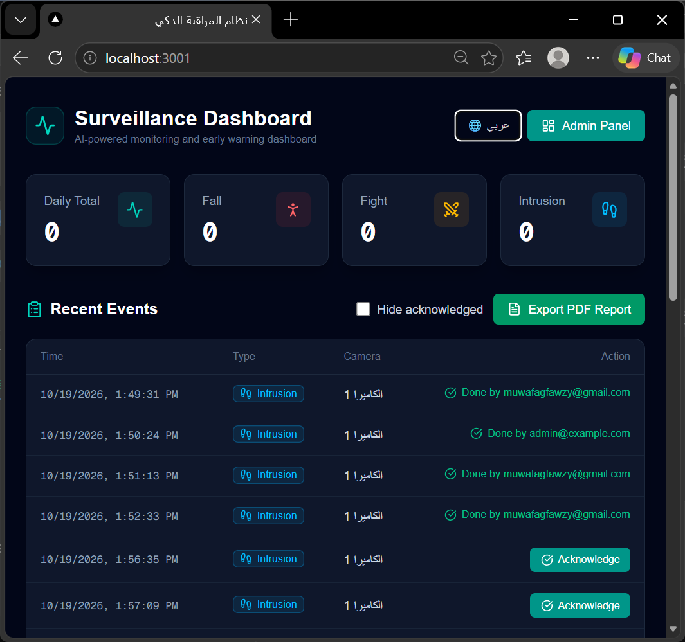
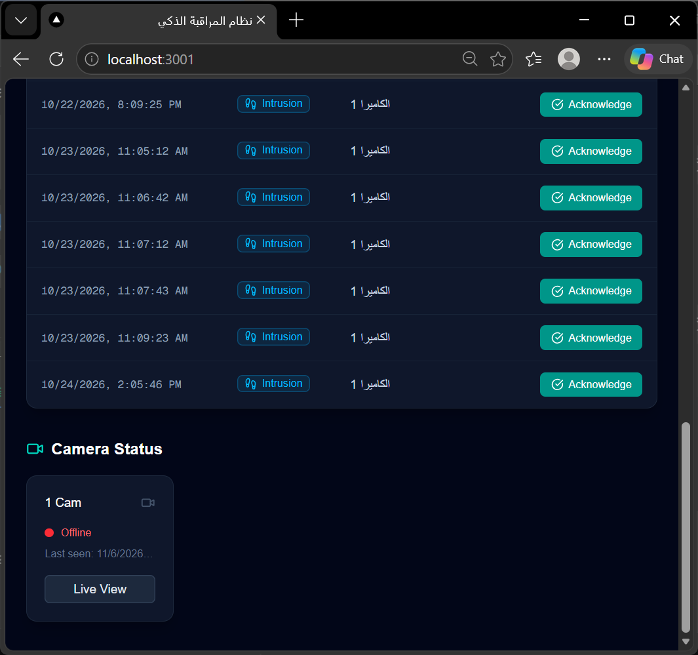
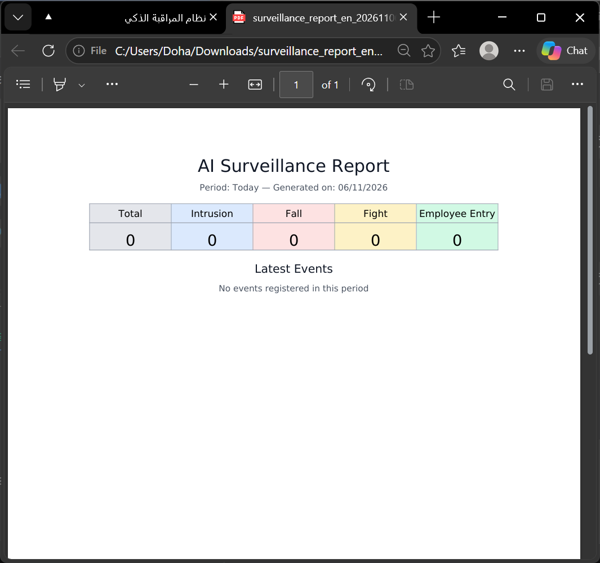
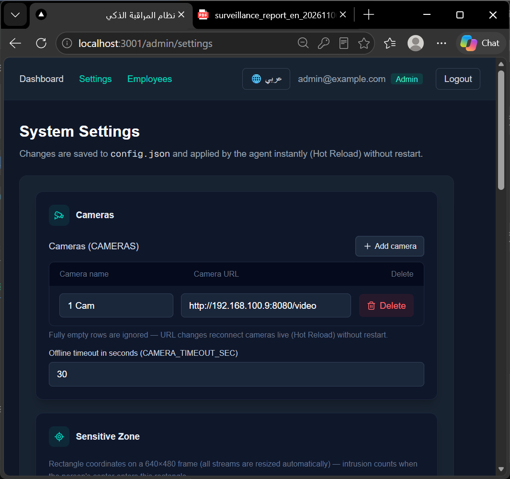
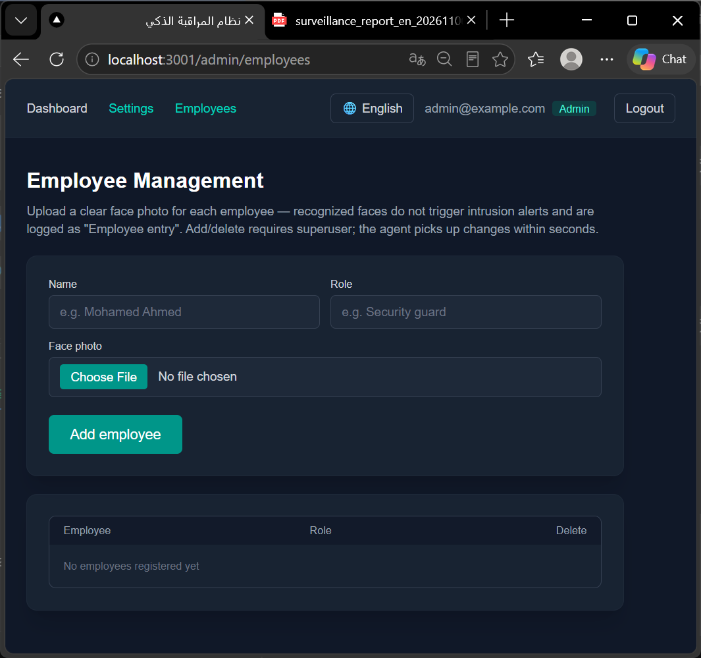

# 🎯 AI Surveillance Agent
**Enterprise-Grade, AI-Powered Threat Detection & Surveillance Platform**

[](https://www.python.org/)
[](https://fastapi.tiangolo.com/)
[](https://nextjs.org/)
[](https://www.docker.com/)
[](https://ultralytics.com/)



## 📖 Overview
**AI Surveillance Agent** is a production-ready, full-stack surveillance system designed for security firms and facility management. It bridges the gap between traditional CCTV cameras and modern AI by eliminating false alarms, recognizing employees, and providing immediate, actionable intelligence to control rooms.

Unlike basic motion detectors, this system uses **YOLOv8** and **ByteTrack** to understand *who* is in the frame and *where* they are, sending instant Telegram/Email alerts with images only when unauthorized personnel enter restricted zones.

---

## ✨ Key Features

### 🧠 Advanced AI & Computer Vision
*   **Face Recognition:** Differentiates between authorized employees and unknown intruders. Employee entries are logged without triggering false alarms.
*   **Multi-Camera Tracking (ByteTrack):** Tracks individuals across frames to prevent duplicate alerts for the same person.
*   **Virtual Zones:** Draw custom restricted zones; alerts trigger only if a person enters and dwells in the zone for a specific time.

### 🖥️ Professional Dashboard
*   **Bilingual UI:** Full support for Arabic (RTL) and English (LTR).
*   **Live View:** Secure MJPEG streaming directly from the dashboard.
*   **Audit Trail:** Acknowledge alerts to log exactly which supervisor reviewed the incident.
*   **PDF & CSV Reporting:** Export professional bilingual PDF reports for legal or client documentation.

### ⚙️ Dynamic & Secure Architecture
*   **Hot-Reload Settings:** Change camera URLs, AI model sizes (n/s/m), or zones from the UI without restarting the system.
*   **JWT Authentication:** Secure, cookie-based authentication for the admin dashboard.
*   **Dockerized:** Complete deployment with `docker-compose` (API, Agent, PostgreSQL, Redis).

---

## 📸 Platform Screenshots

| Event Management & Audit Trail | Professional PDF Reports |
| :---: | :---: |
|  |  |

| Dynamic System Settings | Employee Face Management |
| :---: | :---: |
|  |  |

---

## 🛠️ Tech Stack

| Layer | Technology |
| :--- | :--- |
| **Frontend** | Next.js 16 (React), Tailwind CSS, Lucide Icons |
| **Backend API** | FastAPI, Python-JOSE (JWT), SQLAlchemy |
| **AI / CV** | YOLOv8 (Ultralytics), OpenCV, ByteTrack |
| **Database** | PostgreSQL 15 |
| **Cache / Broker**| Redis |
| **Reporting** | ReportLab (Arabic/English PDF generation) |
| **Deployment** | Docker, Docker Compose |

---

## 🚀 Quick Start (Docker)

1. **Clone the repository:**
   ```bash
   git clone https://github.com/Mowafag100/AI-Surveillance-Agent.git
   cd AI-Surveillance-Agent
Setup Environment Variables:

bash
cp .env.example .env
# Edit .env and add your TELEGRAM_BOT_TOKEN, CHAT_ID, and DB passwords.
Launch the stack:

bash
docker compose up -d --build
Access the Dashboard:

Navigate to http://localhost:3001

Register the first user (automatically becomes Superuser).

Go to /admin/settings to add your IP Camera URL.

Go to /admin/employees to register authorized faces.

🔒 Security & Privacy
100% On-Premise: No video data is sent to external clouds. All AI processing happens locally via the Agent.

Secure by Design: Passwords are hashed using bcrypt, and API access is protected by JWT.

Data Sanitization: Employee face encodings are stored securely, and reports are generated on-the-fly.

Developed by Mowafag Fawzy