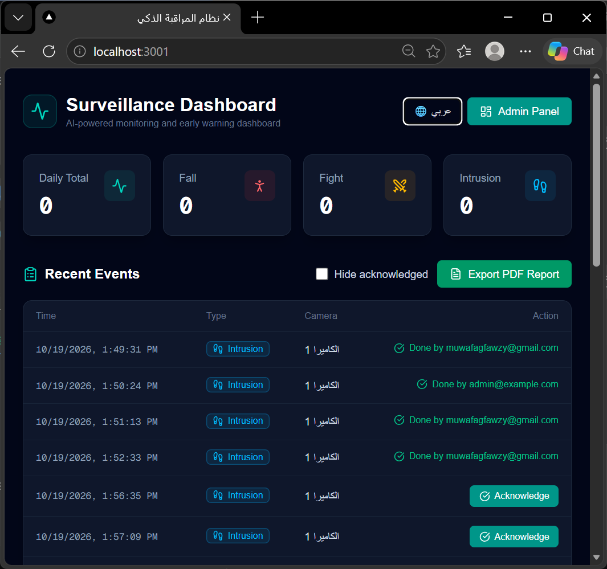

# Mowafag100 — Autonomous Security Surveillance Agent

**An AI agent that watches, decides, and acts on its own.**

[](https://www.python.org/)
[](https://fastapi.tiangolo.com/)
[](https://nextjs.org/)
[](https://ultralytics.com/)
[](https://python.langchain.com/)



## What This Agent Does

Mowafag100 is not a passive CCTV system. It is an **autonomous security agent** that continuously monitors multiple camera feeds, makes contextual decisions about what constitutes a threat, and executes responses—all without waiting for human instruction.

## The Agentic Loop

| Phase | Autonomous Action |
|-------|-------------------|
| **Perceive** | Ingests RTSP/HTTP streams, runs YOLOv8 detection + ByteTrack tracking across multiple cameras. |
| **Decide** | Checks Face Recognition against authorized employees; evaluates zone intrusion, behavioral anomalies (running/fall/loitering), fight detection, and **Forbidden Color/Uniform detection**. Evaluates per-camera time schedules before escalating. |
| **Act** | Sends Telegram/Email alerts with snapshots; logs every decision with reasoning in an Audit Trail; **self-reports camera disconnection autonomously**. |
| **Respond** | LLM assistant (Ollama/LangChain) answers operator queries in natural language about historical events and logs. |

## Key Agentic Capabilities

- **Explainable AI (Decision Audit Trail)**: Every autonomous decision (alert sent, alert suppressed, anomaly escalated, camera offline) is logged with a clear reasoning trace (e.g., *"Person matched employee #12, alert suppressed"*), viewable in the admin dashboard.
- **Context-Aware & Per-Camera Settings**: Admins can set unique schedules, forbidden colors, and anomaly thresholds for *each* camera individually (e.g., Server Room forbids Red on weekends; Gate runs only at night).
- **Forbidden Color Detection**: Ideal for schools and restricted zones. Detects specific uniform colors and alerts if an unauthorized person (student) enters a restricted area.
- **Behavioral & Anomaly Detection**: Detects and classifies Running, Fall, Loitering, Fights (based on IoU spatial overlap), and Crowd Surges.
- **Self-Monitoring & Fault Reporting**: The agent detects when a camera feed drops and autonomously alerts the operator via Telegram. No human trigger required.
- **Face Recognition Integration**: Employee entry is logged silently. Unknown intrusion triggers immediate alert. The agent decides the difference.

## Target Categories (Dubai Create AI Agents Championship)

1. **Best Business AI Agent**: Enabling security firms to reduce false alarms, cut response time, and maintain continuous surveillance without constant human monitoring.
2. **Best Societal AI Agent**: Transforming school security by detecting fights, crowd surges, and preventing unauthorized access to server/electrical rooms using Uniform Color Detection—all while ensuring 100% On-Premise privacy.

## Tech Stack

| Layer | Technology |
|-------|------------|
| Frontend | Next.js 16, Tailwind CSS, Lucide Icons |
| Backend API | FastAPI, JWT, SQLAlchemy (Async) |
| AI / CV / LLM | YOLOv8, OpenCV, ByteTrack, LangGraph, Ollama |
| Database | PostgreSQL 15 |
| Cache | Redis |
| Reporting | ReportLab (Arabic/English PDF) |
| Deployment | Docker Compose |

## Quick Start

```bash
git clone https://github.com/Mowafag100/AI-Surveillance-Agent.git
cd AI-Surveillance-Agent
cp .env.example .env
# Add TELEGRAM_BOT_TOKEN, CHAT_ID, DB passwords
docker compose up -d --build
```
Access the dashboard at http://localhost:3001. The first registered user automatically becomes Superuser.

Demo Video (English subtitles)


The video demonstrates: intrusion detection → Telegram alert received → agent autonomously reports camera disconnection.

Security & Privacy
100% On-Premise Processing: No video leaves the local network. LLM (Ollama) runs locally.

Secure Authentication: bcrypt password hashing, JWT-protected API.

Data Privacy: Employee face encodings are stored server-side only; all report downloads are logged with user ID and timestamp.

Developed by Mowafag Fawzy
